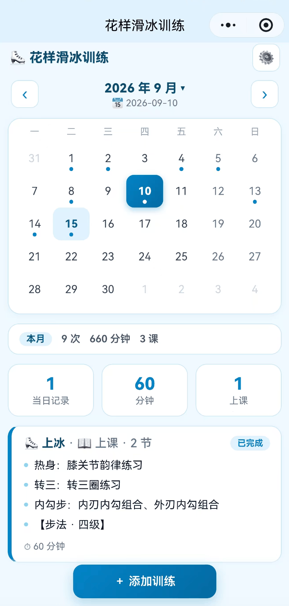
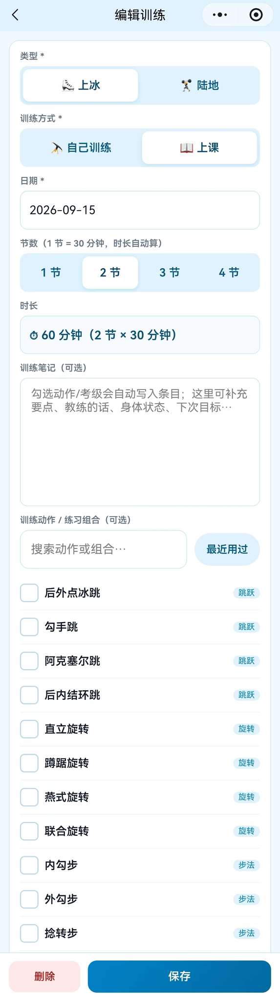
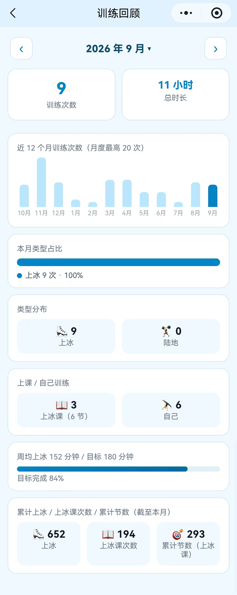
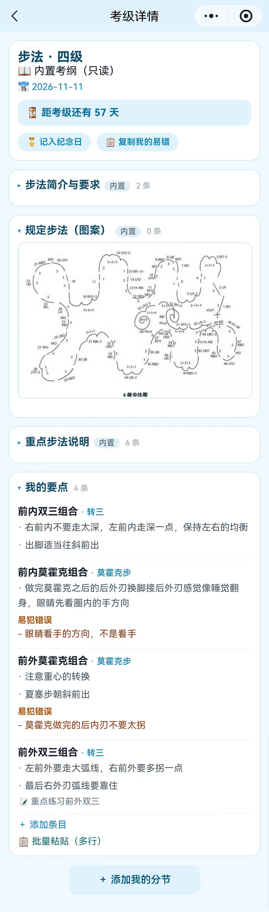
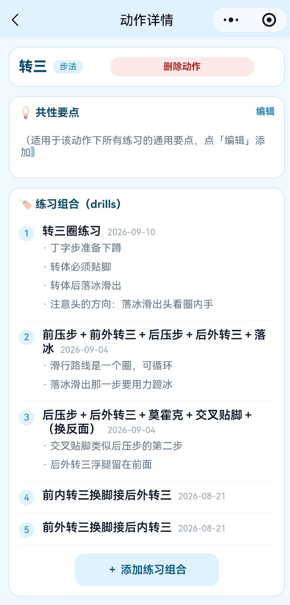
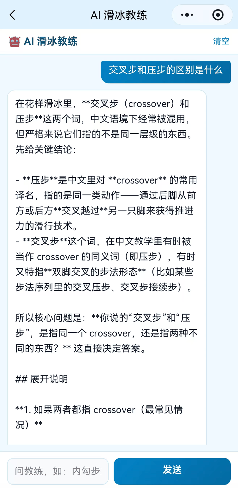
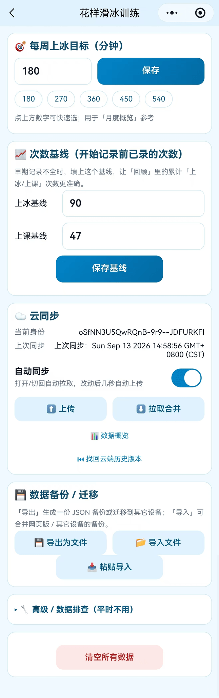
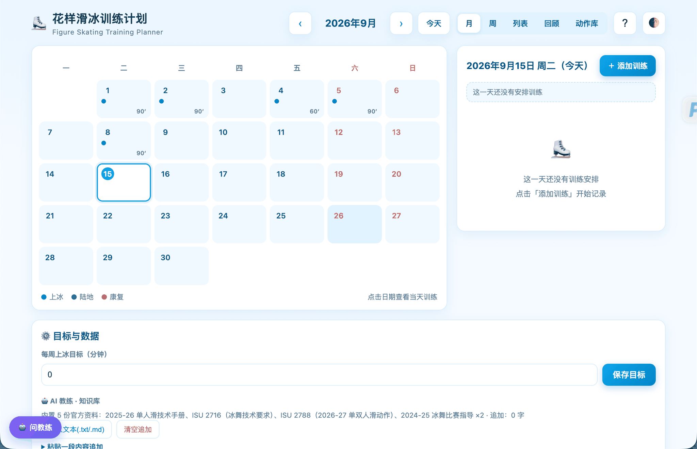

# 花样滑冰训练助手

从个人训练记录迁移的真实需求出发，借助 AI 编程工具持续迭代的训练管理应用。产品先以 PWA 实现，随后扩展为微信小程序，逐步加入历史笔记结构化导入、专业知识检索、训练建议和视频姿态自查实验。

**个人项目｜产品设计与 AI 辅助开发｜最近核对：2026-11-24**

> 版本说明：本文结合最新本地实现与仓库已有代码、截图整理。`miniprogram/` 已包含历史导入、专业检索、周建议与视频姿态实验等主要实现，与独立开发目录仍有少量版本差异；本次 17 套测试针对独立开发目录运行。云端部署、真机效果及公开发布状态未在本次复核中验证。

## 为什么做

最初用手机内置笔记记录花滑训练，换手机时迁移麻烦，也缺少可视化回顾。随着持续自用，需求扩展为：保留教练要点、追踪训练结构、准备考级，以及查询专业术语和规则。

产品围绕三件事迭代：**让记录更方便，让历史数据可信，让 AI 的输出有依据、可检查。**

## 已实现的主要能力

| 场景 | 当前实现 | 设计重点 |
|---|---|---|
| 日常记录 | 月历、训练时段、课时、动作与组合、课堂笔记、冰感评分 | 减少重复输入，保留用户手写内容 |
| 训练回顾 | 月度统计、近 12 个月趋势、训练分类、教师分布、冰感与训练间隔分析 | 将记录转成可回顾的数据 |
| 历史笔记迁移 | 日期规则识别、AI 辅助切分、固定 JSON 格式导入、结果预览与选择、去重 | 不让模型猜测时长，不把未确认结果直接写入 |
| 专业问答 | DeepSeek 云函数、领域知识检索、来源列表、赛季与项目识别 | 区分来源、适用项目与历史版本，允许回答不确定 |
| 周训练建议 | 由代码汇总训练次数、时长、分类、久未练动作、考级等信息，再交给模型生成建议 | 事实计算由代码完成，模型负责组织建议 |
| 数据持续使用 | JSON 备份、跨版本迁移保护、自动同步、分块上传、历史快照 | 降低升级和多端同步造成数据损失的风险 |
| 训练辅助 | 动作库、练习进度、考级笔记、纪念日、装备使用时长、全文搜索 | 将日常记录与长期训练管理连接起来 |

AI 相关云函数目前限制开发者本人使用。当前以个人自用和内测迭代为主，公开发布状态待确认，暂无规模化用户指标。

## 核心设计

### 1. 把杂乱历史笔记转成可核对的数据

输入是不同日期格式、口语表达和缺失信息混在一起的训练笔记。采用三条入口：本地日期规则识别、复制提示词由用户自行转格式、开发者内测的 AI 云函数识别。

处理流程为：

**原始笔记 → 按日期切分 → 日期与字段校验 → 标记歧义和重复 → 用户预览选择 → 写入记录。**

- 约定 AI 只返回日期、训练类型和原文；提示词要求不编日期、不润色、不补充时长。
- 代码检查日期是否合法、类型是否在允许范围内；这些检查不能证明模型忠实保留了原文，因此保留人工核对。
- 时长只从原文明示的“分钟／小时／节数”通过规则提取；未写时长时保留为 0，不由模型猜测。
- 区分“计入训练统计”和“仅作笔记”；后者通过 `noteOnly` 排除在次数、时长等计算之外。
- 使用日期与内容生成稳定标识，避免同一段笔记重复导入。

这个流程让导入结果可检查、可选择，并与训练统计保持一致。

### 2. 专业知识检索：从术语参考扩展到带元数据的资料库

当前本地知识库包含 **1,239 个知识块、24 个文档名称条目，正文约 110 万字符**。知识块包含项目、文档、赛季、语言、页码和章节等字段。这是资料组织规模，不是模型训练样本数或效果指标。

- 使用中文二元组、英文词和中英文术语映射进行关键词检索，并结合文档、章节等信息加权排序。
- 识别单人滑、双人滑、冰舞、队列滑和考级场景，进行项目过滤；加入赛季识别、历史版本降权与标签。
- 将检索片段及出处传给 DeepSeek，在界面展示来源，提示词要求说明翻译和旧版本的适用边界。
- 当前未使用向量数据库、模型微调，也没有建立完整的标准答案评测集。

**已知局限**：赛季主要通过加权与历史标记处理，尚非严格版本隔离；抽查发现指定旧赛季时可能召回其他赛季，考级中的自由滑与步法也可能混淆。可继续通过场景标签、检索约束和评测样本迭代。

### 3. 视频姿态自查：将模型输出转成有质量门槛的反馈

最新代码已经包含视频姿态自查实验，当前在页面注册表中启用；旧开发说明中“页面已移除”的描述已落后于代码。

实现链路为：

**本地选择视频 → 逐帧解码 → 像素格式识别与转换 → 调用微信 VisionKit 人体关键点检测 → 关键点后处理 → 指标计算与骨架回放。**

- 处理 RGBA、YUV 等帧格式差异，提供参数诊断、阈值调整和关键点映射校准。
- 对关键点跳变、短时缺失、抖动等问题，采用异常处理、短缺口插值、中值／EMA 平滑和骨骼长度约束。
- 从关键点计算膝角、上身倾斜、浮足高度、单足持续时间等候选指标，并支持回放、逐帧查看和关键瞬间定位。
- 根据主体在画面中的大小等规则提示输入质量；不满足门槛时隐藏部分量化结果。

**当前定位为实验原型**：调用现成关键点能力，并未自行训练视觉模型。本次未复验真机视频，不承诺指标准确率，也不能宣称已经可靠识别用刃、跳跃高度、旋转圈数或完成专业动作评分。平滑后的骨架更连续，也不等于更接近真实姿态。

## 数据与模型的职责划分

周训练建议先由代码汇总记录，再将事实摘要发送给模型，不发送训练笔记正文；结果按周保存复用。模型组织建议，代码负责次数、时长等确定性计算。

升级时先留本地快照，再迁移并比对记录数量和文字；云同步加入防覆盖检查、分块上传和历史快照。上述措施用于降低数据丢失风险，不能保证任何异常情况下都不丢数据。

## 已有迁移与产品设计记录

以下案例保留自仓库原有项目记录；其中历史对账和包体数字未在本次复核中重新测量。

### 六年训练数据的迁移与对账

我 2020–2026 的训练记录原本是纯文本：一份 548 行的流水账（每行"日期 + 上课/自练"）、两份按日期分块的课堂笔记。

- **清洗**：剔除 11 条非滑冰记录（芭蕾 / 软开 / 基训 / 现代 / 身韵），混合行（如"自练101+芭蕾软开+基训"）保留并原样存档
- **对齐**：课堂笔记按日期并入同一天的记录；流水账里没有的日期（3 天）单独补录
- **建模**：上课记录带"节数"（我早期每次 1 节、2021 年后每次 2 节），时长自动 = 节数 × 30 分钟
- **对账**：用我笔记本里的累计编号当锚点，**反推每一次课的节数**——107 个锚点误差为 **0**，导入后"累计节数 **271**"与纸笔记录的"第 271 节"**完全一致**

> 数据迁移的验收标准不是"跑完了"，而是**能和原始记录对账**。差 1 节我都能发现——因为锚点在。

### 包体限制与分包设计

主包一度到 **2.6MB** 直接上传失败（微信主包上限 2MB）：一张 1.9MB 的被误放进项目的头像图 + 一张 600KB 的扫描步法图。

- 把不该打包的图移出项目、把扫描图压到 **155KB**（灰度 + 缩放 + 优化）
- 把低频的**考级页做成分包** `packageExam`，首页 `preloadRule` 预加载
- 结果：**主包 119KB / 子包 187KB**，后面再加 10 级步法图也放得下

### 内置考纲与个人笔记分层

考级大纲是官方内容，不该让用户去编辑，也不该随用户数据漂移。所以数据模型拆成两层：

- **考纲本体写在代码里**（`utils/const.js` 的 `SYLLABUS`，只读，随版本更新，带页码出处）
- **用户数据只存个性化部分**（某条考纲下的"★我的要点 / 易犯错误"、自建分节与条目、图片、考级日期）

好处是：考纲更新不用迁移用户数据，也不会出现"两份考纲打架"。

## 截图

  
  
  

  
  
  

  
  

（截图清单见 [`screenshots/`](screenshots/)。）

  

> 同一份数据的另一端：**PWA 版**（纯前端单文件、可安装到桌面/手机主屏、离线可用）。
> 小程序与 PWA 两套存储通过 JSON 导出/导入按 id 合并互通。

## 我独立负责的部分

个人项目的需求取舍、交互设计、数据结构与统计口径、知识与提示词组织、AI 工具协作开发、功能验证及迭代均由我负责。代码实现使用 AI 编程工具辅助，底层模型与云服务来自 DeepSeek、微信等平台；不将平台能力表述为自研模型。

## 本次验证与边界

2026-11-24，对最新本地版本运行现有测试：**17 套自测、1,514 项通过断言，均无失败**；静态检查无阻断问题，另有 5 处样式重复提示。需要个人导出数据的 `realdata` 套件未运行。

这些测试主要覆盖应用逻辑、数据处理和部分代码结构检查，**不能替代模型效果评测、云端联调或真机验收**。本次另执行了 3 个检索样例，发现上述赛季及考级细分问题；未据此计算检索准确率。

## 代码与界面展示

- 小程序主要实现：[`miniprogram/`](./miniprogram/)。
- PWA 实现：[`pwa/`](./pwa/)。
- 已有 9 张界面截图：[`screenshots/`](./screenshots/)。

历史导入、周建议与姿态实验的界面展示将随迭代补充。知识库全文生成物 `kb_data.js` 未入库，复现 AI 云函数需按部署说明补齐本地资料及环境配置。
