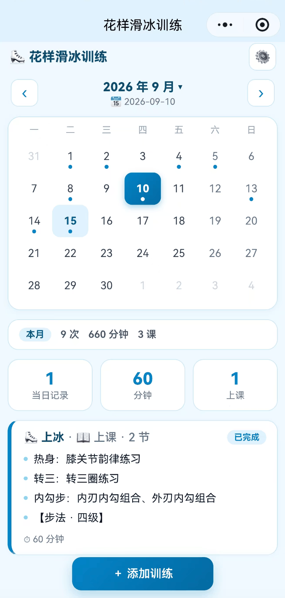
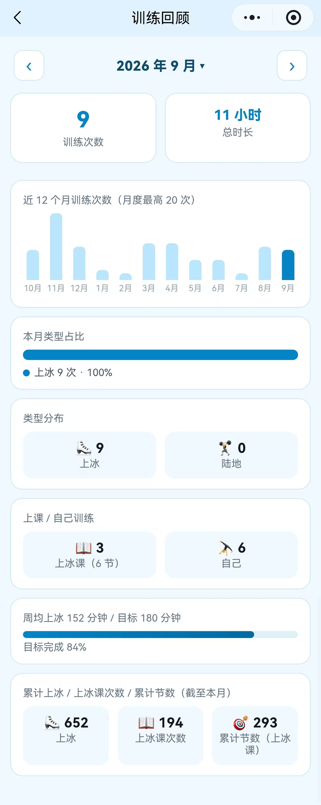
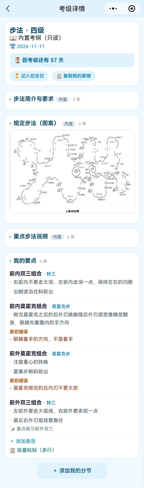

# AI 原生工具箱 · AI-Native Toolbox

> 我做的三个东西：一个我自己每天在用的花滑训练助手，一个 AI 陪伴手账应用，和一套把我的求职流程自动化掉的工作流。
>
> 都是我亲手做出来的，都跑起来了。

**Chloe** ｜ 清华大学经济管理学院 GMBA ｜ 前华为（财经数字化 3 年 + AI 行业营销 1 年）

---

## 为什么有这三个

我在一个 20 万人的组织里待了 4 年。前 3 年做财经数字化，亲手搭支撑全球 230+ 子公司的预算预测系统；第 4 年做 AI 行业营销，在一线看企业买了很多 AI 却用不起来。

这两件事让我形成一个判断：**AI 落地的瓶颈，已经从技术侧移到了组织侧。**

所以我自己开始造东西。不是学教程，是真的有痛点就自己拆掉它——下面三个项目，每一个都始于一个我自己真实遇到的问题。

---

## 三个项目

### 01 · 花样滑冰训练助手 — 记录、数据整理与 AI 应用

**起点**：手机笔记迁移麻烦，训练记录缺少可视化回顾。由个人自用需求出发，从 PWA 迭代为微信小程序。

**最新能力（2026-11-24 核对）**：

- **训练管理**：记录与回顾、动作库、考级笔记、装备使用统计、历史搜索。
- **历史笔记结构化导入**：日期规则与 AI 辅助切分，加入字段校验、预览确认、去重和“仅作笔记／计入统计”的口径区分。
- **专业知识检索**：当前本地资料库 1,239 个知识块，使用关键词、中英文术语映射及项目／赛季元数据组织检索，展示来源。旧赛季和考级细分场景仍有误召回，尚未完成系统效果评测。
- **基于数据的周训练建议**：代码汇总训练事实，再由 DeepSeek 组织建议；仅发送事实摘要，不发送训练笔记正文。
- **视频姿态自查实验**：实现逐帧解码、人体关键点调用、异常与抖动处理、指标计算及骨架回放。真机效果待复验，不主张专业动作评分能力。
- **持续使用保障**：版本迁移快照与自检、云同步防覆盖、分块上传、历史快照恢复。

**我的角色**：个人项目，负责产品需求、交互与数据方案、提示词和知识组织、AI 辅助开发、验证与迭代。

**状态**：以个人自用和内测迭代为主，AI 云函数限制本人使用；本次未核实公开发布及云端部署状态。对最新本地代码运行的 17 套现有自测全部通过（1,514 项通过断言），不等同于模型效果或真机验收。

> 本仓库已包含主要功能实现和 9 张界面截图；独立开发目录仍有少量版本差异，知识库全文生成物需本地补齐。最新版本内容、实验边界及演示建议见 [完整项目介绍](./01-skating-coach/README.md)。

  
  
  

---

### 02 · Friend Journal — AI 朋友型电子手账

**问题**：情绪需要一个出口，但写日记的门槛太高——不知道写什么，也坚持不下来。

**做了什么**：一款以「AI 朋友」陪伴为核心的电子手账应用。用户每天和 AI 倾诉，AI 理解情绪后**自动生成排版精美的手账页面**，并提供周/月情感总结。

**技术栈**：
- 前端：React + TypeScript + Vite + Tailwind
- 后端：Node.js + Express + PostgreSQL + Redis
- AI：OpenAI API（对话理解 + 手账内容生成 + 排版生成）

**我负责的**：这是一个三人小组的 AI 编码课程项目（见 [CONTRIBUTIONS.md](./CONTRIBUTIONS.md)），我负责前端页面与组件、AI 提示词设计（[docs/AI_PROMPTS.md](./02-friend-journal/docs/AI_PROMPTS.md)）、以及演示流程设计。

**我在这个项目里最想解决的一个问题**：让 AI 的输出**稳定地符合审美预期**。生成手账不是"生成一段文字"，而是要控制排版结构、装饰元素、色彩关系。我的做法是把开放式的"生成一页手账"拆成**固定 schema 的 JSON 输出 + 前端渲染**——让模型只负责理解与表达，不可控的排版交给代码。

> 输出稳定性本质上不是提示词问题，是**职责划分**问题。

---

### 03 · 把我的求职流程自动化掉的工作流

**问题**：我每周要看很多 JD，手工比对"这份工作和我匹不匹配"极其耗时，而且判断口径会漂移——同一份 JD 今天看和明天看，结论可能不一样。

**做了什么**：用 Claude Code 搭了一套**求职运营工作流**：

- 用一份 `CLAUDE.md` 把**判断口径、输出格式、目录约定**全部固化下来——相当于给 AI 一个可复用的"工作说明书"
- JD 原文自动归档 + 结构化分析（必须满足 / 加分项 / 匹配度评估三段式输出）
- 简历库按方向分层管理，定制版本有命名规范和归属追溯
- 投递状态用带颜色编码的表格跟踪
- 进入面试环节自动生成 briefing

**为什么这件事和"AI 原生组织"有关**：这本质上是一个**微型的 AI 原生组织实验**——一个人 + 一排 agent，用文档契约（而不是管理指令）来保证输出质量和一致性。我把"判断标准"写进文件里，agent 就变成了一个可复制的、不会疲劳的协作者。

**我从中得到的真实体会**：让 agent 干活不难，**难的是让它每次都按同一个标准干**。所以真正的关键是写清楚契约，而不是写更长的提示词。

---

## 一个横贯三个项目的主题

回头看，这三个东西其实在回答同一个问题：

> **在没有标准答案的事情上，怎么把判断变得可靠、可复现？**

- 花滑助手：怎么让 AI 的动作建议可靠（本地知识库 + 官方优先原则）
- Friend Journal：怎么让 AI 生成的内容稳定符合审美预期（结构化输出约束）
- 求职工作流：怎么让 AI 的判断口径不漂移（文档契约）

这也是我对 **AI 原生组织 / AI for Science / AI for Education** 这三个方向共同的兴趣所在。

---

## 当前状态与下一步

| 项目 | 状态 | 下一步 |
|---|---|---|
| 花样滑冰训练助手 | 已有历史导入、专业检索、周建议及姿态实验的主要代码与界面截图；以自用／内测为主 | 补新增功能录屏，建立检索和视频效果评测样本 |
| Friend Journal | 演示版可跑 | — |
| 求职工作流 | 每天在用 | 把输出格式约束做成可复用的 skill |

---

## 联系方式

- GitHub：[lily113](https://github.com/lily113)
- 清华大学经济管理学院 · GMBA 2025–2027

> 本仓库中的项目为我个人完成或作为小组核心成员参与完成，具体归属见 [CONTRIBUTIONS.md](./CONTRIBUTIONS.md)。
